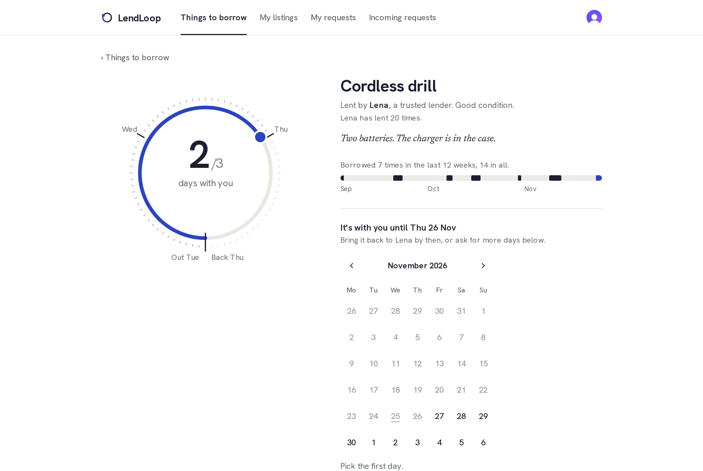
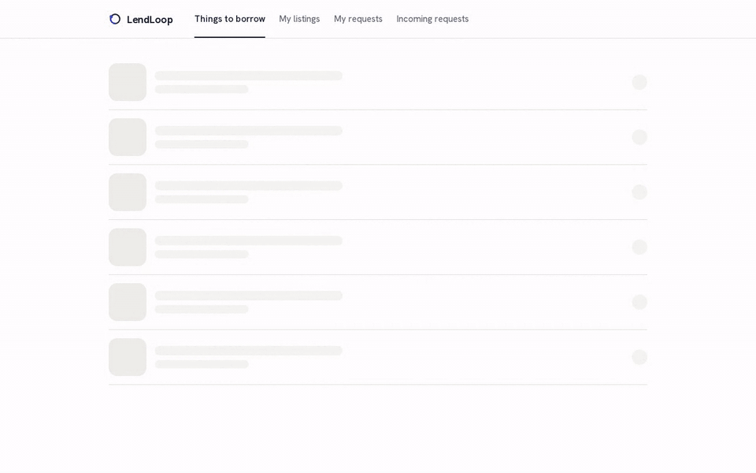
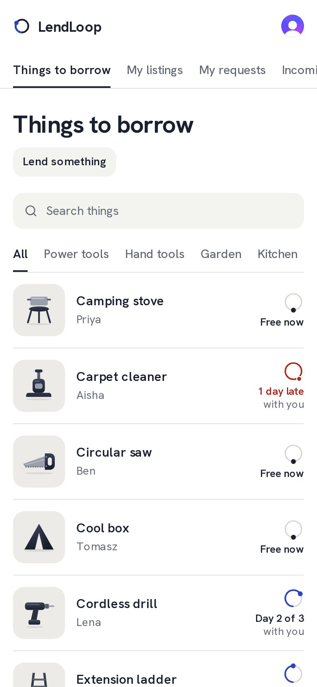
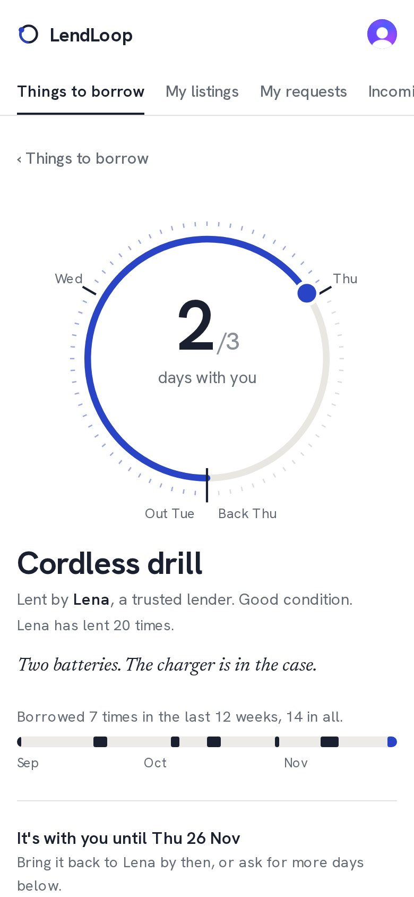
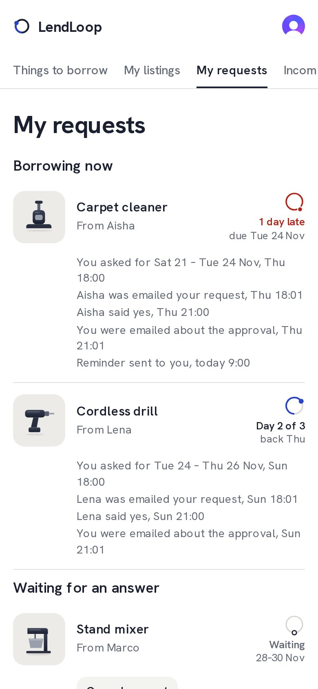
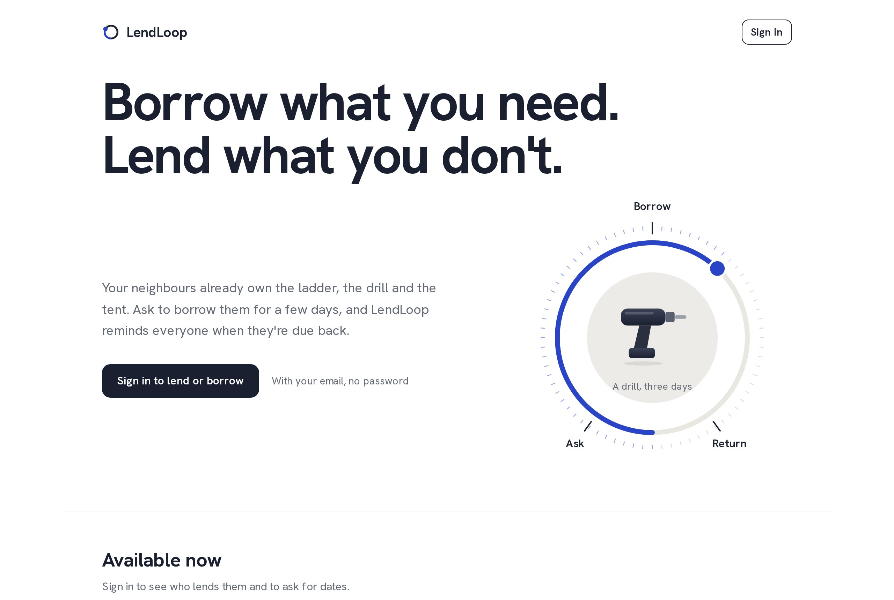
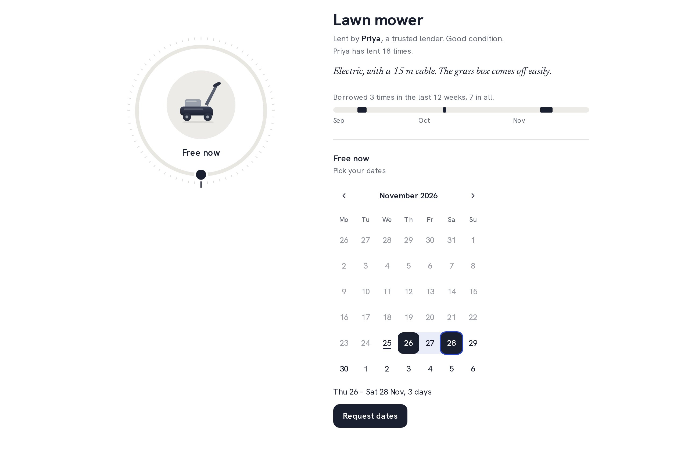
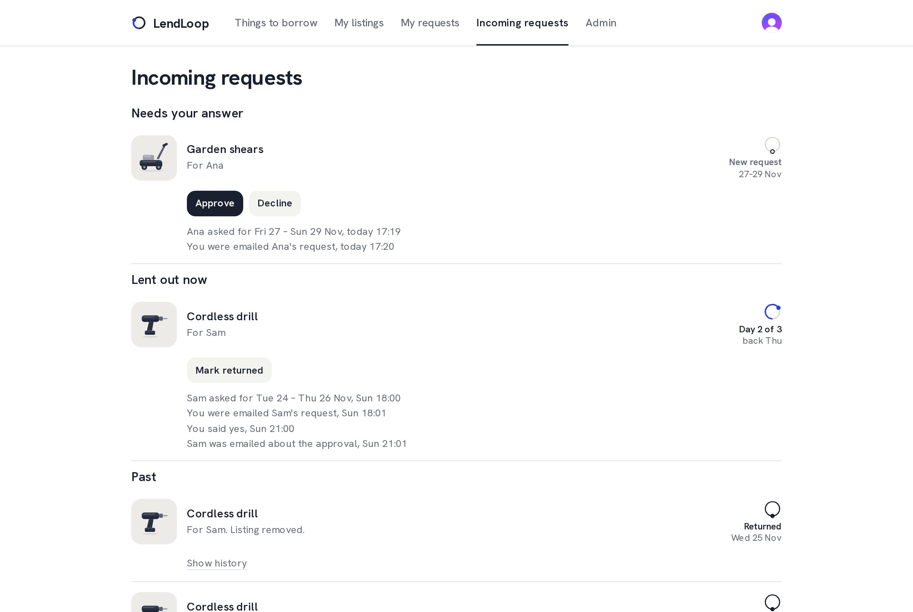
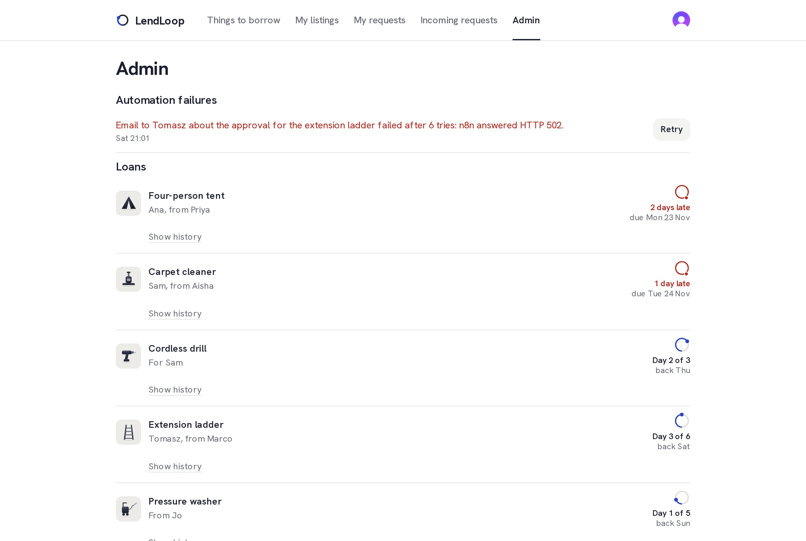
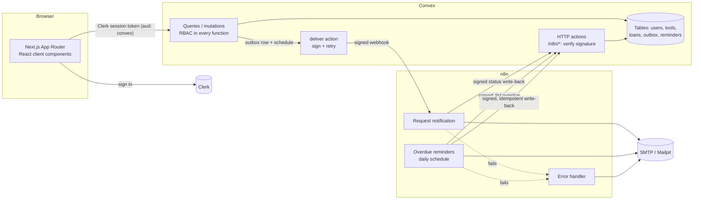

# LendLoop

**Borrow what you need. Lend what you don't.**

A neighborhood lending board: neighbors list the things they're happy to lend (tools, garden and
kitchen kit, camping gear), ask to borrow each other's for a few days, and n8n handles the emails and
the overdue reminders.

Stack: **Next.js 16** (App Router) · **Clerk** (auth) · **Convex** (data and backend logic) ·
**n8n** (workflow automation) · **TypeScript** · Tailwind CSS and shadcn/ui · Vitest + convex-test.



---

## Contents

- [What it does](#what-it-does)
  - [Design](#design)
- [Requirements checklist](#requirements-checklist)
- [Local setup](#local-setup)
  - [Sample data](#7-sample-data)
- [Environment variables](#environment-variables)
- [Architecture](#architecture)
- [Roles and access control](#roles-and-access-control)
- [Automation with n8n](#automation-with-n8n)
- [Security decisions](#security-decisions)
- [Data minimization](#data-minimization)
- [Tests](#tests)
- [How this was built](#how-this-was-built)
- [What I'd change for production](#what-id-change-for-production)

## What it does



<p align="center">
  
  
  
</p>

- **Public page** (`/`): the tagline, what's free right now (item name and category only, no owner
  details), how a loan works, and "Sign in to lend or borrow" (Clerk, with an emailed code).
- **Signed-in app**:
  - **Things to borrow** (`/tools`): search and category tabs over a row per item, each with its
    status: free now, day 2 of 3, or late. Who has an item is shown only to its owner, that borrower
    and admins; everyone else sees "On loan, back Thu".
  - **An item** (`/tools/[id]`): a dial with one tick per day of the current loan, the owner's note,
    how often it was borrowed in the last 12 weeks, and a calendar to request dates (past and booked
    days can't be picked; a range over them says why). The owner gets edit and remove instead.
  - **My listings** (`/listings`): your things with their status, and a form to list another.
  - **My requests** (`/requests`): what you're borrowing, waiting for, have coming up and borrowed
    before, each with its history in plain words, the automation included ("Lena was emailed your
    request", "Reminder sent to you, today 9:00"). Cancel before a loan starts.
  - **Incoming requests** (`/incoming`): approve, decline, mark returned. Steps that can't be undone
    ask first, and every action confirms itself in a toast.
  - **Admin** (`/admin`, admins only): automation failures first (with a retry), every loan, every
    listing (remove), and people (mark a Trusted Lender).
- **n8n workflows**: a notification whenever a request is created or changes status, and a daily
  reminder to every borrower with an overdue loan. Both are signed in both directions, retried,
  idempotent and visible when they fail.

<p align="center">
  
  
</p>
<p align="center">
  
  
</p>

### Design

Every item has a loop. At home, its dot rests at the bottom of a ring; during a loan the dot travels
clockwise as the days pass and comes home when it's returned; late, the ring turns red. On an item's
page the loop is a dial with one tick per loan day. Everything around it stays quiet: one ink color,
ultramarine only for a loan in progress, red only for late, Hanken Grotesk throughout, rows separated
by hairlines instead of cards, and shaded drawings on a neutral plate where owners' photos will go.
The shadcn/ui components (Radix underneath) are restyled to these tokens in `app/globals.css`. The
words and numbers the screens show (dates, statuses, the dial's geometry, the 12-week strip) are plain
functions in `lib/`, each covered by a test. Screens and copy follow British spelling.

## Requirements checklist

Every requirement of the brief, where it lives, and the test that holds it in place.

| Requirement | Where | Checked by |
|---|---|---|
| Public page: name, tagline, available tools with name and category only | `app/page.tsx`, `tools.listPublic` | `access.test.ts` (public page) |
| "Sign in to lend or borrow" wired to Clerk | `app/SignInCta.tsx` | `e2e/borrowing.spec.ts` |
| Only signed-in users can act | `requireUser` in every function (`convex/lib/auth.ts`); `proxy.ts` redirects | `access.test.ts` (signed-out visitors) |
| List a tool: name, category, condition, description | `tools.create`, `components/ListingForm.tsx` | `access.test.ts` (validated on the server) |
| Request to borrow for a date range | `loans.request`, `components/items/RequestDates.tsx` | `loans.test.ts`, `lib/booking.test.ts`, `e2e/borrowing.spec.ts` |
| Approve or decline requests on your own tools; mark returned | `loans.approve`, `loans.decline`, `loans.markReturned` | `loans.test.ts` (each step only by the right person) |
| All tools with availability, filterable by category | `tools.list`, `app/(app)/tools/page.tsx` | `loop.test.ts`, `lib/filter.test.ts` |
| My listings, My requests, Incoming requests | `app/(app)/listings`, `requests`, `incoming` | `timeline.test.ts`, `e2e/borrowing.spec.ts` |
| Admin: remove any listing, view all loans, mark a Trusted Lender | `convex/admin.ts`, `tools.remove` | `access.test.ts` (admin) |
| Users act only on their own listings and loans | owner and borrower checks in `convex/tools.ts`, `convex/loans.ts` | `access.test.ts`, `loans.test.ts` |
| Roles enforced in Convex, not only in the UI | `requireAdmin`; `users.setRole` is internal | `access.test.ts` (nobody can make themselves admin) |
| Request notification: Convex calls an n8n webhook with only the fields needed | outbox + `notifications.deliver`; `n8n/workflows/lendloop-request-notification.json` | `automation.test.ts` (signed, minimal payload) |
| Overdue reminders: daily, from a Convex HTTP endpoint, status written back | `reminders.overdue` / `reminders.record`, `convex/http.ts`; `lendloop-overdue-reminders.json` | `automation.test.ts`, `n8n/workflows.test.ts` |
| Payloads signed and verified in both directions | `convex/lib/hmac.ts`, `convex/http.ts`, the n8n Code nodes | `automation.test.ts` (RFC 4231 vector, tampering, replay), `n8n/workflows.test.ts` |
| Secrets only in environment variables and n8n credentials | `.env.local`, `.env.n8n`, n8n credentials | `n8n/workflows.test.ts` (no secrets in the JSON) |
| Idempotent write-backs | upsert by key in `reminders.record`; `notifications.report` | `automation.test.ts` (retried write-backs) |
| Retries and an error workflow; failures never silent | backoff in `notifications.ts`; `lendloop-error-handler.json`; Admin, failures first | `automation.test.ts`, `admin.test.ts` |
| Bonus: recent automation activity on each loan | the loan timeline (`loanView`, `lib/timeline.ts`) | `timeline.test.ts`, `lib/timeline.test.ts` |
| Repository, exported workflows, README, production note | this repository, `n8n/workflows/`, this file | [What I'd change for production](#what-id-change-for-production) |

## Local setup

You need Node.js 22+, Docker (for n8n and Mailpit) and a free Clerk account. Convex can run on
your machine (no account needed) or in the cloud.

The easiest setup runs everything on your machine, so Convex and n8n can call each other. A cloud
Convex deployment can't reach `localhost`: see [Using a cloud Convex deployment](#using-a-cloud-convex-deployment).

Nothing to install, or not enough RAM for Docker? [Run it in GitHub Codespaces](#run-it-in-github-codespaces):
the same steps, in a cloud machine in your browser.

[](https://codespaces.new/Ledsav/lendloop)

### 1. Install

```bash
npm install
cp .env.local.example .env.local
cp .env.n8n.example .env.n8n
```

Generate the two HMAC secrets and n8n's encryption key (`openssl rand -hex 32`, three times) and put
them in `.env.n8n`.

### 2. Clerk

1. Create an application in the [Clerk dashboard](https://dashboard.clerk.com) (email sign-in is
   enough).
2. Turn on the **Convex integration** (Configure → Integrations → Convex). It makes Clerk's session
   tokens ones Convex accepts (`aud: "convex"`) and shows your **Frontend API URL** (the issuer).
3. Copy the publishable key and secret key into `.env.local`, or let the Clerk CLI write them:

   ```bash
   npx -y clerk@latest auth login
   npx -y clerk@latest link --app <your application id>
   npx -y clerk@latest env pull
   ```

4. Add the user's email and name to the session token. The integration doesn't, and LendLoop needs
   the email to send notifications and to find you in `users:setRole` (sign-in fails without it).
   In the dashboard: Configure → Sessions → Customize session token, with these claims:

   ```json
   { "email": "{{user.primary_email_address}}", "name": "{{user.full_name}}", "given_name": "{{user.first_name}}" }
   ```

   Or with the Clerk CLI, once the project is linked:

   ```bash
   npx -y clerk@latest config patch --json '{"session":{"claims":{"email":"{{user.primary_email_address}}","name":"{{user.full_name}}","given_name":"{{user.first_name}}"}}}'
   ```

### 3. Convex

```bash
npx convex dev
```

When it asks, pick **Start without an account (run Convex locally)**. You can also log in and
choose a local or cloud dev deployment. This writes `CONVEX_DEPLOYMENT` and `NEXT_PUBLIC_CONVEX_URL` to `.env.local` and pushes the
functions. In a second terminal, set the backend's environment variables:

```bash
npx convex env set CLERK_JWT_ISSUER_DOMAIN https://<your-app>.clerk.accounts.dev
npx convex env set N8N_LOAN_EVENTS_WEBHOOK_URL http://localhost:5678/webhook/lendloop/loan-events
npx convex env set LENDLOOP_TO_N8N_SECRET <same value as in .env.n8n>
npx convex env set N8N_TO_LENDLOOP_SECRET <same value as in .env.n8n>
```

Until the n8n variables are set, the app works and events are marked "skipped".

### 4. n8n and Mailpit

```bash
docker compose up -d
docker compose exec n8n n8n import:credentials --input=/lendloop/credentials/mailpit-smtp.json
docker compose exec n8n n8n import:workflow --separate --input=/lendloop/workflows
docker compose exec n8n n8n publish:workflow --id=LendLoopErrors01
docker compose exec n8n n8n publish:workflow --id=LendLoopEvents01
docker compose exec n8n n8n publish:workflow --id=LendLoopRemind01
docker compose restart n8n
```

This imports the **LendLoop SMTP** credential (Mailpit: host and port only, there is nothing secret
in it) and the three workflows, and publishes them. Publish the error handler too: n8n 2.x only
runs an error workflow that is published. Then open n8n at <http://localhost:5678> and create the
owner account (local only).

Every email lands in Mailpit at <http://localhost:8025>. To use a real SMTP server instead, edit
the **LendLoop SMTP** credential in n8n; its password stays encrypted in n8n.

### 5. Run the app

```bash
npm run dev
```

Open <http://localhost:3000> and sign in. To make yourself an admin (there's deliberately no way to
do it from the browser):

```bash
npx convex run users:setRole '{"email": "you@example.com", "role": "admin"}'
```

### 6. Try the flows

1. List something in **My listings**, then sign in as a second user (a private window), open it and
   pick dates on its calendar: **Request dates**.
2. The lender's email appears in Mailpit, and the loan's history in **My requests** says "Lena was
   emailed your request".
3. Approve, decline or mark returned in **Incoming requests**: the borrower gets an email each time.
4. Overdue reminders: loans can't be created in the past, so backdate one (development only), then
   run **LendLoop: overdue reminders** from the n8n editor ("Execute workflow"):

   ```bash
   npx convex env set LENDLOOP_DEV_TOOLS true
   npx convex data loans                       # find the loan's _id
   npx convex run devtools:backdateLoan '{"loanId": "<loan id>", "days": 5}'
   ```

   Run it twice: the second run sends nothing (one reminder per loan per day).

### 7. Sample data

To see every screen full, seed the development deployment. Sign in once as the two Clerk test users
first (`lena+clerk_test@example.com` and `sam+clerk_test@example.com`, code 424242), then:

```bash
npx convex env set LENDLOOP_DEV_TOOLS true
npx convex run devtools:seed      # once; running it again changes nothing
npx convex run devtools:reseed    # start over, with dates relative to today
```

It adds ten neighbours who exist only in Convex (they can't sign in), 29 things to borrow in every
category, and loans in every state: requested, out, late, coming up, returned (twelve weeks of
history and more), declined and cancelled. Lena and Sam own and borrow some of them, and one
approval email is marked failed so the admin page has something to retry. The loans' emails and
reminders are written straight into their history as already sent: nothing is scheduled and nothing
is emailed when it runs. From the next daily run, the overdue-reminder workflow reminds the two late
borrowers like any other (both have example.com addresses, so in development they land in Mailpit). With your own Clerk accounts, name two that have signed in:
`npx convex run devtools:seed '{"realEmails": ["you@example.com", "friend@example.com"]}'`.

### Using a cloud Convex deployment

A cloud deployment can't call `localhost:5678`. Either expose n8n with a tunnel (for example
`cloudflared tunnel --url http://localhost:5678`) and use that URL in `N8N_LOAN_EVENTS_WEBHOOK_URL`,
or use n8n Cloud. In both cases set `LENDLOOP_CONVEX_SITE_URL` in `.env.n8n` to
`https://<your-deployment>.convex.site`.

### Run it in GitHub Codespaces

The repository includes a dev container (`.devcontainer/devcontainer.json`): Node 22 and Docker, on
a 2-core, 8 GB machine, which fits in GitHub's free monthly Codespaces hours. Creating the codespace
runs `npm ci` and `scripts/codespaces-env.sh`, which points the app at Convex's forwarded URL
(in `.env.development.local`) and makes ports 3000 and 3210 public, so your browser can reach the
app and Convex. Sign-in is still required in the app; n8n and Mailpit stay private to you.

Then follow steps 1 to 6 above in the codespace's terminal, with two differences:

- **Clerk keys:** the CLI's browser sign-in can't call back into a codespace, so copy the
  publishable and secret keys from the Clerk dashboard (API keys) into `.env.local`.
- **Addresses:** open the app, Mailpit and n8n from the **Ports** tab (`https://<codespace>-3000.app.github.dev`
  and so on), not `localhost`. GitHub shows a one-time warning page before each forwarded address:
  choose **Continue**. Webhook and Convex addresses inside the codespace stay as in step 3.

Run `npx convex dev` and `npm run dev` from the codespace's own terminal: `next.config.ts` reads the
codespace's name from the environment to trust its forwarded address, and only that one.

## Environment variables

| Variable | Where | What |
|---|---|---|
| `NEXT_PUBLIC_CONVEX_URL` | `.env.local` | Convex client URL (written by `npx convex dev`) |
| `NEXT_PUBLIC_CLERK_PUBLISHABLE_KEY`, `CLERK_SECRET_KEY` | `.env.local` | Clerk keys |
| `CLERK_JWT_ISSUER_DOMAIN` | Convex | Clerk Frontend API URL; Convex verifies tokens against it |
| `N8N_LOAN_EVENTS_WEBHOOK_URL` | Convex | The n8n webhook that receives loan events |
| `LENDLOOP_TO_N8N_SECRET` | Convex and `.env.n8n` | HMAC secret, Convex → n8n |
| `N8N_TO_LENDLOOP_SECRET` | Convex and `.env.n8n` | HMAC secret, n8n → Convex |
| `LENDLOOP_DEV_TOOLS` | Convex (development only) | `true` enables `devtools:backdateLoan`, `devtools:seed` and `devtools:reseed` |
| `N8N_ENCRYPTION_KEY` | `.env.n8n` | Encrypts credentials stored in n8n |
| `LENDLOOP_CONVEX_SITE_URL` | `.env.n8n` | Base URL of the Convex HTTP actions (`.convex.site`) |
| `LENDLOOP_MAIL_FROM`, `LENDLOOP_OPS_EMAIL` | `.env.n8n` | Sender address; where failure alerts go |

`.env.local` and `.env.n8n` are git-ignored. The SMTP server's settings live in the n8n credential,
not in the workflows (`n8n/credentials/mailpit-smtp.json` is the local Mailpit one, with no secret).

## Architecture

The full tour, with a diagram of every flow and the reasoning behind each decision, is in
[docs/ARCHITECTURE.md](docs/ARCHITECTURE.md).



- **Next.js** renders the public page on the server (`preloadQuery`, so the first paint already has
  the list) and keeps it live on the client. The signed-in pages are client components using
  Convex's reactive queries: an approval in one browser shows up in the other without a reload.
  `proxy.ts` (Next 16's middleware) redirects signed-out visitors away from the app routes. That's a
  convenience only: the access checks live in Convex.
- **Convex** holds all data and rules. `convex/lib/auth.ts` resolves the caller from the verified
  Clerk token; every public function starts with `requireUser` or `requireAdmin`.
- **Outbox**: when a loan changes, the mutation writes an `outbox` row in the same transaction and
  schedules `notifications.deliver`. If the mutation fails, no event exists; if it succeeds, the
  event is either delivered or ends up visibly failed.
- **n8n** sends the emails and runs the daily schedule. It never touches the database: it gets
  exactly the fields it needs from signed requests and reports back through signed endpoints.

Code map:

| Path | What |
|---|---|
| `convex/schema.ts` | Tables and indexes |
| `convex/tools.ts`, `convex/loans.ts` | Listings and the loan state machine |
| `convex/admin.ts`, `convex/users.ts` | Admin functions, user sync, role bootstrap |
| `convex/notifications.ts` | Outbox delivery to n8n (sign, retry, give up) |
| `convex/reminders.ts`, `convex/http.ts` | Overdue list and the endpoints n8n calls |
| `convex/lib/hmac.ts` | Request signing and verification (shared by both directions) |
| `app/`, `components/`, `lib/` | Next.js UI |
| `n8n/workflows/*.json` | Exported workflows (import them as in step 4) |
| `n8n/credentials/mailpit-smtp.json` | The local SMTP credential (Mailpit, no secret) |
| `docker-compose.yml` | n8n + Mailpit |

## Roles and access control

Two roles, stored in the Convex `users` table (`role: "admin" | "user"`). Everyone starts as `user`.
Admins are promoted with an internal mutation (`users:setRole`) that only someone with deployment
access can run from the CLI or dashboard. No client code path can change a role.

Rules, all enforced inside the Convex functions (the UI only hides what you can't do):

| Action | Who |
|---|---|
| See the public list (available tools: name, category) | Anyone |
| Browse all tools, request to borrow | Signed-in users (not your own tool) |
| Create a listing | Signed-in users |
| Edit a listing | Its owner only (admins can't rewrite other people's listings) |
| Remove a listing | Its owner, or an admin (owners can't while it's lent out) |
| Approve / decline a request, mark returned | The tool's owner |
| Cancel a request (or an approved loan before it starts) | The borrower |
| See a loan and its activity | The borrower, the lender, admins |
| View all loans, mark Trusted Lender, retry failed notifications | Admins |

Other rules: no double booking (approval checks overlapping approved loans), dates validated on the
server (no past start dates, end ≥ start, at most 30 days), state transitions checked (for example,
only a `requested` loan can be approved). Removing a listing declines its open requests and cancels
loans that haven't started, notifying each borrower. Listings are soft-deleted so loan history stays
intact.

## Automation with n8n

### Request notification (`lendloop-request-notification.json`)

`Webhook (raw body) → Verify signature → valid? → 202 → Skip repeated deliveries → Build email → Send email → Sign report → Report to LendLoop`

- Convex POSTs every loan event (requested, approved, declined, cancelled, returned) with an HMAC
  signature. n8n checks it against the **raw request body** with a timing-safe comparison and a
  5-minute timestamp window, and answers 401 if it fails.
- It answers **202** as soon as the event is verified, then works asynchronously, so a slow SMTP
  server never makes Convex retry an event n8n already has.
- **Skip repeated deliveries** (Remove Duplicates across executions, keyed on `deliveryId`) drops
  an event Convex sent twice, for example when the 202 got lost.
- The email node retries 3 times. The outcome (`sent` / `failed`) is written back to Convex, signed,
  and shows on the loan in the app.

### Overdue reminders (`lendloop-overdue-reminders.json`)

`Every day at 9:00 → Sign request → Fetch overdue loans → One item per loan → Build reminder → Send reminder → Sign write-back → Write back to LendLoop`

- Convex's `/n8n/overdue-loans` endpoint returns approved, unreturned loans past their end date
  that haven't had a reminder **sent** today, each with a `reminderKey` (`loanId:date`).
- The write-back (`/n8n/reminders`) is an **upsert on `reminderKey`**: retries and re-runs update
  the same record (they're counted in `writes`) instead of creating duplicates. `sent` is final, so a
  late `failed` can't undo it.
- The reminder email node deliberately **doesn't retry**: n8n retries a node by re-running it for
  all items, which would email borrowers who already got one. A failed reminder is recorded as
  `failed` and the next day's run tries again. The write-back node does retry: it's idempotent.
- If a write-back still fails after its retries, the run is stopped with an error, which reaches
  the error workflow.

### Errors (`lendloop-error-handler.json`)

Both workflows name it as their error workflow (it must be published, like the others). It emails `LENDLOOP_OPS_EMAIL` the workflow name,
the failed node, the error and a link to the execution (not the execution's data). On the Convex
side, notifications that can't be delivered after 6 attempts (30 s, 1, 2, 4, 8 min backoff) are
marked `failed` and listed on the admin page with a **Retry** button. Retrying creates a new
`deliveryId`, so n8n's de-duplication lets it through. Nothing fails silently.

## Security decisions

- **Authentication**: Clerk issues the session; Convex verifies its token (issuer, `aud: convex`) on
  every call. Functions identify the caller only through `ctx.auth`, never through arguments.
- **Authorization in the backend**: each public query and mutation checks the caller and the
  resource (`requireUser`, `requireAdmin`, ownership checks). The tests call the functions directly,
  as an attacker with a valid account would, and check that they refuse.
- **No privilege escalation from the client**: the role lives in Convex; promoting a user is an
  internal mutation. `users.store` always creates `user` and never changes the role.
- **Internal functions**: delivery, reminders, write-backs and dev tools are `internal*` functions,
  unreachable from the browser. The only ways in from outside are the authenticated public API and
  the signed HTTP endpoints.
- **Signed integration, both directions**: HMAC-SHA256 over `timestamp.rawBody`, a 300-second
  window against replays, constant-time comparison, a different secret per direction, a 16 KB body
  limit, strict body validation, and a bare `401 unauthorized` that doesn't say why.
- **Secrets**: only in environment variables (Convex env, `.env.n8n`) and n8n credentials. The
  workflow JSON references `$env.*` and a credential by name; a test fails if anything that looks
  like a secret appears in it.
- **Input validation**: Convex argument validators (types, enums for category, condition and status)
  plus server-side checks for lengths and dates. React escapes all output.
- **HTTP headers**: `X-Frame-Options: DENY`, `nosniff`, a strict referrer policy, a permissions
  policy, no `X-Powered-By`.
- **Errors**: functions throw `ConvexError` with user-facing messages; anything unexpected shows a
  generic message in the UI.

## Data minimization

- The **public query** returns tool name and category only: no ids, owners, descriptions or
  unavailable tools.
- Other users only ever see a **first name** (and the Trusted Lender badge). **Emails never reach
  the browser**: not in lists, not in `users.me`, not in the admin view.
- The **event sent to n8n** holds only what the email needs: the recipient's first name and email,
  the other person's first name, the tool name and the dates. The overdue list does the same.
- n8n **doesn't store successful executions** (they'd contain emails), prunes the rest after 7 days,
  and alert emails link to an execution instead of copying its data.
- Soft-deleted listings keep loan history for accountability, without exposing it to anyone but the
  loan's participants and admins.

## Tests

```bash
npm test            # Vitest
npm run typecheck   # Next.js app and Convex functions
npm run lint
npm run e2e         # Playwright, in a real browser (below)
```

**Browser tests** (`e2e/borrowing.spec.ts`) run the borrowing flow end to end against a running app
with the sample data: the public page shows names and categories but no owners; Sam requests dates
on the calendar, Lena approves and marks them returned, and Sam's history tells the story; a range
across booked days explains itself; a cancellation reaches the lender. They sign in as Clerk's test
users (code 424242, no inbox needed) and each makes its own request, so they can run again on the
same data. Install the browser once (`npx playwright install chromium`), start the app, seed it
(step 7), then `npm run e2e`; `E2E_BASE_URL` points them at another address.

- `convex/tests/access.test.ts`: the public list hides owners; signed-out callers are refused;
  users can't edit or remove other people's listings; admin functions refuse non-admins; the role
  bootstrap is internal.
- `convex/tests/loans.test.ts`: the loan state machine, who may do each step, no double booking,
  date validation, everyone sees only their own loans.
- `convex/tests/automation.test.ts`: the HMAC test vector (RFC 4231), tamper, replay and wrong-secret
  rejection; the signed, minimal webhook payload; retries with backoff, giving up and the admin
  retry; signed endpoints refusing bad requests; idempotent reminder and notification write-backs.
- `n8n/workflows.test.ts`: the exported workflows' structure (node types and versions available in
  the pinned n8n, connections, error workflow), no secrets in the JSON, and **the JavaScript inside
  the Code nodes**, run against the same signing code Convex uses: a payload signed by Convex
  verifies in n8n, and n8n's write-backs verify in Convex.
- `convex/tests/loop.test.ts`: each item's state (free, out "day N of M", late) and who may see who
  has it (the owner, that borrower and admins only).
- `convex/tests/item.test.ts`: the item page's query: use over the last 12 weeks, the next free day,
  booked dates, a bad or removed id, and no names or emails for anyone else.
- `convex/tests/timeline.test.ts`: a loan's history in order, from each side, and who cancelled.
- `convex/tests/admin.test.ts`: admin rows carry first names and counts, never emails.
- `convex/tests/seed.test.ts`: the sample data refuses to run without the dev flag or the two real
  accounts, fills every category and loan state, schedules and emails nothing, and runs twice safely.
- `lib/*.test.ts`: the interface's words and numbers: dates ("Fri 27 Nov", "today 9:00"), status
  lines, the dial's geometry, the 12-week strip, search and category tabs, date-range checks (on the
  server's UTC day), which drawing each item gets.

## How this was built

With the help of an AI coding assistant (Claude Code), which the brief allows. The work followed a
written design brief and plan; every change was checked with the automated tests, CI, a fresh review
of the whole branch, and the two-person flow run end to end against a real Clerk, Convex and n8n
setup (`e2e/`).

## What I'd change for production

- **Hosting**: a Convex production deployment, a Clerk production instance, n8n self-hosted in
  queue mode with Postgres and HTTPS (or n8n Cloud), secrets in a secret manager.
- **Email**: a transactional provider (Postmark, SES) with SPF/DKIM, templates, and per-user
  notification preferences with unsubscribe links.
- **Secret rotation**: a key id in the signature header and two active secrets during a rotation.
- **User lifecycle**: sync users from Clerk webhooks (verified with Svix) instead of on sign-in, so
  email changes and account deletions propagate; delete or anonymize a user's data on request.
- **Abuse and scale**: rate limits on requests and listings (for example Convex's rate-limiter
  component) and on the HTTP endpoints; pagination; a denormalized availability field instead of
  computing it per tool.
- **Admin accountability**: an audit log of admin actions, MFA for admins, and roles managed in one
  place.
- **Time zones**: store each user's time zone; send reminders in the morning of their time zone
  rather than 9:00 UTC.
- **Observability**: Sentry for Next.js and Convex, Convex log streams to Datadog, an alert when
  failed outbox events pile up, n8n alerts to Slack or PagerDuty instead of email.
- **Retention**: delete outbox and reminder rows after a set period; keep n8n's execution pruning.
- **Delivery guarantees**: to rule out a duplicate reminder entirely, send each reminder through its
  own sub-workflow execution with an idempotency key at the email provider.
- **CI/CD**: lint, typecheck, tests and a build run on every push (`.github/workflows/ci.yml`); add
  dependency scanning and preview deployments, and keep the n8n workflows in Git with n8n's source
  control feature.
- **Content Security Policy**: add a CSP tuned for Clerk and Convex.
