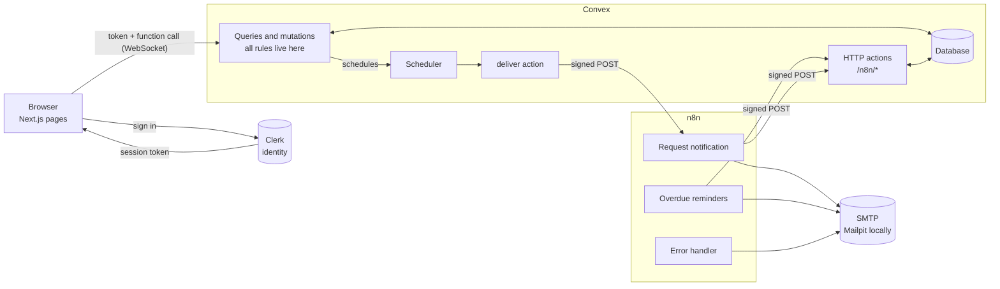
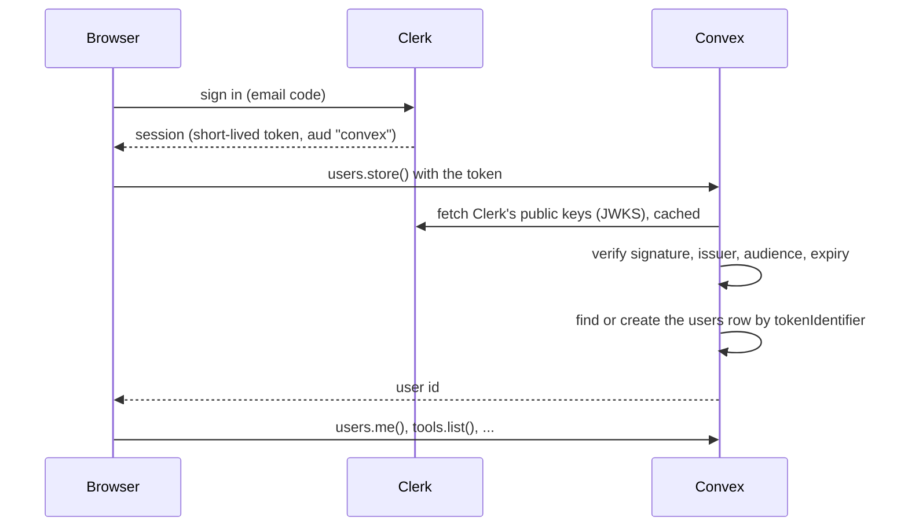
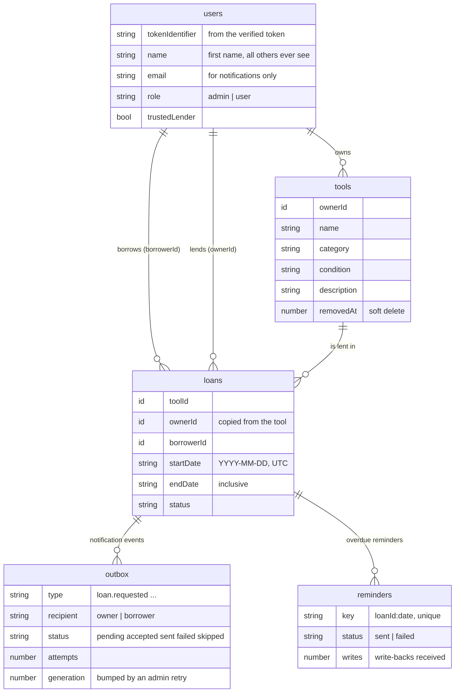
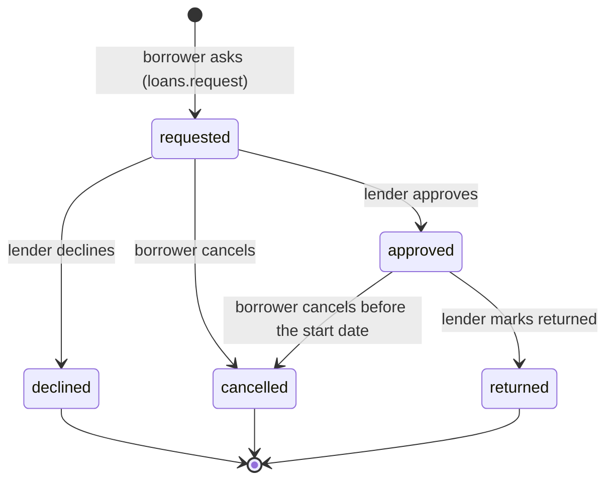
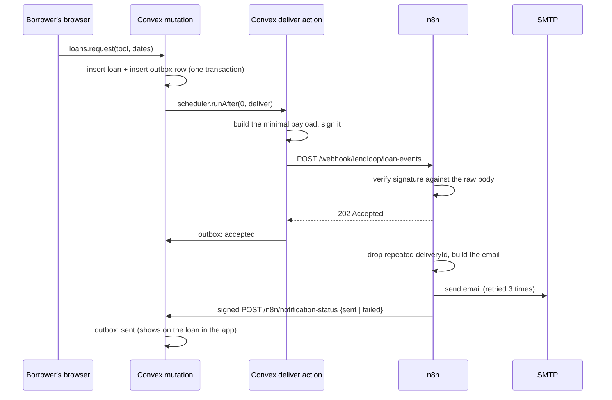
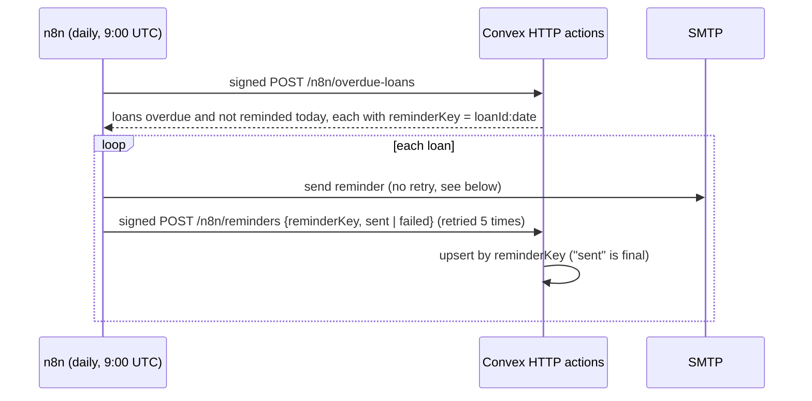

# LendLoop architecture

How the pieces fit together, how each flow works step by step, and why it's built this way. The
[README](../README.md) covers setup; this document is the deeper tour.

- [The pieces](#the-pieces)
- [Sign-in and the user record](#sign-in-and-the-user-record)
- [Data model](#data-model)
- [The loan lifecycle](#the-loan-lifecycle)
- [Access control](#access-control)
- [Request notifications: the outbox](#request-notifications-the-outbox)
- [Overdue reminders](#overdue-reminders)
- [Signing requests between Convex and n8n](#signing-requests-between-convex-and-n8n)
- [Failures, retries and idempotency](#failures-retries-and-idempotency)
- [Data minimization](#data-minimization)
- [Frontend](#frontend)
- [Tests](#tests)
- [Design decisions](#design-decisions)

## The pieces



| Piece | Job | Doesn't do |
|---|---|---|
| **Next.js** (App Router) | Renders the pages; the public page on the server, the signed-in pages as client components with live Convex queries. `proxy.ts` sends signed-out visitors away from app routes. | Make access decisions. The redirect is a convenience; Convex is the gatekeeper. |
| **Clerk** | Sign-up, sign-in, sessions. Issues a short-lived signed token (JWT) for the signed-in user. | Store roles or app data. |
| **Convex** | Database, every business rule, role checks, the outbox, the HTTP endpoints n8n calls. | Send emails or run schedules for reminders (n8n's job). |
| **n8n** | Sends emails, runs the daily reminder schedule, alerts on failures. | Touch the database. It only sees the fields it's sent and reports back through signed endpoints. |

## Sign-in and the user record



- `ConvexProviderWithClerk` (`app/ConvexClientProvider.tsx`) attaches the Clerk token to every
  Convex call and refreshes it before it expires.
- `convex/auth.config.ts` tells Convex which tokens to trust: issuer = `CLERK_JWT_ISSUER_DOMAIN`,
  audience = `convex`. Convex downloads Clerk's public keys from that issuer and rejects anything
  not signed by them.
- **Clerk's Convex integration** makes Clerk's session token carry `aud: "convex"`. The token
  also needs the user's `email`, `name` and `given_name` claims (README, setup step 2): LendLoop
  needs the email for notifications, and `users.store` refuses a sign-in without one.
- **`users.store`** (`convex/users.ts`) runs once per sign-in (`lib/useStoreUser.ts`). It
  creates the user's row on first sign-in, always as role `user`, and refreshes the name and email
  afterwards. It never changes the role.
- The row is keyed by `tokenIdentifier` (`issuer|subject`), which comes from the verified token,
  so a caller can't claim to be someone else by passing an id.
- **Roles** live in this row, not in Clerk. Promoting someone is `users:setRole`, an internal
  mutation: only someone with deployment access can run it (CLI or Convex dashboard).

## Data model



Every query reads through an index (`convex/schema.ts`), for example `loans.by_tool_status` for
"approved loans of this tool" and `loans.by_status_end` for "approved loans that ended before
today". Dates are plain `YYYY-MM-DD` strings in UTC, so comparing them as strings compares them as
dates.

## The loan lifecycle



`convex/loans.ts` enforces each arrow:

- **Who:** only the lender approves, declines or marks returned. Only the borrower requests (never
  for their own tool) or cancels.
- **From where:** `expectStatus` refuses a step that doesn't start from the right status, so a
  declined request can't be approved later, and a loan can't be returned twice.
- **Dates** (`convex/lib/dates.ts`): valid calendar dates, no start in the past, end on or after
  start, at most 30 days.
- **No double booking:** a request is refused if it overlaps an approved loan, and the approval
  checks again (two requests for the same days can both exist; only one can be approved).
- **Overdue** isn't a stored status. It's computed: approved, and the end date is before today.
  Availability on the browse page works the same way (`convex/lib/loans.ts`).
- Every transition writes an outbox event in the same transaction (next sections).

Removing a listing (`tools.remove`) is a soft delete: it declines open requests and cancels loans
that haven't started, notifying each borrower. An owner can't remove a tool that is lent out right
now; an admin can, for moderation.

## Access control

Every public Convex function starts by working out who's calling:

```ts
const viewer = await requireUser(ctx);   // throws "Please sign in." without a valid token
const admin = await requireAdmin(ctx);   // throws "Admins only." for everyone else
```

Then it checks the resource: `tool.ownerId === viewer._id`, `loan.borrowerId === viewer._id`,
and so on. The UI hides buttons you can't use, but that's only for comfort. The tests call the
functions directly, the way someone with a valid account and a script would, and check that they
refuse.

| Layer | What it does | Trusted? |
|---|---|---|
| UI | Hides actions you can't take | No: anyone can call Convex functions directly |
| `proxy.ts` | Redirects signed-out visitors from app routes | No: a convenience |
| Convex functions | Verify the token, check role and ownership, validate input | **Yes: the only place rules are enforced** |
| Internal functions | `setRole`, delivery, reminders, dev tools | Not callable from the browser at all |

## Request notifications: the outbox



Why an outbox:

- A Convex **mutation** is a database transaction and can't make network calls. An **action**
  can. So the mutation records the event and schedules an action to deliver it.
- Both happen in the same transaction: if the mutation fails, there's no event; if it succeeds,
  the event exists and its delivery is scheduled. An event can't be lost between "saved" and
  "sent to n8n".
- `notifications.deliver` retries failed deliveries with backoff (30 s, 1, 2, 4, 8 min) and gives
  up after 6 attempts, marking the event `failed` so it shows on the admin page.
- n8n answers **202** right after verifying the signature, before sending the email. A slow mail
  server then never makes Convex think the delivery failed and send it again.
- When no n8n is configured (local development), events are marked `skipped` and the app keeps
  working.

## Overdue reminders



- The list only contains loans without a `sent` reminder for today, so running the workflow twice
  sends nothing the second time.
- The write-back is an **upsert keyed on `reminderKey`**: a retried write-back updates the same
  row (counted in `writes`) instead of creating a duplicate. A late `failed` can't overwrite a
  `sent`.
- The reminder email node deliberately **doesn't retry**. n8n retries a node by re-running it for
  all its items, which would email borrowers who already got their reminder. A failed reminder is
  recorded as `failed`, and tomorrow's run tries again.
- If a write-back still fails after its retries, the workflow stops with an error, which reaches
  the error workflow.

## Signing requests between Convex and n8n

Both directions use the same scheme (`convex/lib/hmac.ts`, and the same code inside n8n's Code
nodes):

```
X-LendLoop-Timestamp: 1764075600
X-LendLoop-Signature: v1=hex( HMAC-SHA256( secret, "1764075600." + rawBody ) )
```

| Choice | Why |
|---|---|
| HMAC with a shared secret | Proves the request came from someone holding the secret and that the body wasn't changed on the way. |
| Timestamp inside the signed string, 300 s window | A captured request can't be replayed later. |
| Sign the **raw body** | Re-serialized JSON can differ byte for byte. n8n's webhook keeps the raw body for this. |
| Constant-time comparison | Comparing strings with `===` stops at the first difference, which leaks timing. |
| A different secret per direction | A leaked n8n-side secret can't forge events into n8n, and the other way round. |
| Bare `401 unauthorized` | Doesn't tell an attacker which check failed (the reason goes to the server log). |
| 16 KB body limit, strict field checks | Rejects oversized or malformed requests before any work. |

Secrets live only in environment variables (Convex env, `.env.n8n`) and n8n credentials. The
exported workflow JSON reads `$env.LENDLOOP_TO_N8N_SECRET` and references the SMTP credential by
name, and a test fails if anything that looks like a secret appears in it.

## Failures, retries and idempotency

| Failure | What happens | Where you see it |
|---|---|---|
| n8n unreachable or answers non-2xx | Convex retries with backoff, then marks the event `failed` | Admin page: **Automation failures**, with a Retry button |
| Same event delivered twice (lost 202) | n8n's Remove Duplicates drops a repeated `deliveryId` | Nothing is sent twice |
| Admin retries a failed event | `generation` + 1, so the new `deliveryId` passes n8n's de-duplication | The loan's activity |
| Email fails to send | Notification: retried 3 times, then reported `failed`. Reminder: reported `failed` at once, retried tomorrow | Loan activity, admin page |
| Write-back to Convex fails | Retried 5 times (safe: it's idempotent); then the workflow errors | Error workflow emails `LENDLOOP_OPS_EMAIL` |
| Any n8n workflow error | The error workflow sends an alert with the workflow, node, error and a link to the execution (not its data) | Ops inbox |

**Idempotent** means doing it twice has the same effect as doing it once. Here:
`notifications.report` ignores a repeat of the current status and never downgrades `sent`, and
`reminders.record` upserts by key.

## Data minimization

- **Public page:** tool name and category, nothing else (no ids, owners or descriptions).
- **Other users** only ever see a first name and the Trusted Lender badge. Emails never reach the
  browser: not in lists, not in `users.me`, not on the admin page.
- **n8n** gets only what the email needs: the recipient's first name and email, the other
  person's first name, the tool's name and the dates.
- **n8n keeps no successful executions** (they'd contain emails) and prunes failed ones after 7
  days. Alerts link to an execution instead of copying its data.
- **Soft-deleted listings** keep loan history for accountability, visible only to that loan's
  participants and admins.

## Frontend

```
app/
  page.tsx                 public page: preloadQuery on the server, live on the client
  (app)/layout.tsx         signed-in shell: nav, user sync, error state
  (app)/tools/             browse: search, category tabs, a row per item with its loop
  (app)/tools/[id]/        an item: the dial, 12 weeks of use, a date-range calendar to request dates
  (app)/listings/          my listings: list something; edit and remove from the item page
  (app)/requests/          my requests: each loan's history in plain words, cancel
  (app)/incoming/          requests for my things: approve, decline, mark returned
  (app)/admin/             admins only (Convex enforces it; the page just asks)
components/ui/             shadcn/ui primitives (Radix), restyled to the design tokens
components/loop/           the loop instruments: mini dial, dial, landing dial, 12-week strip, logo
components/items/, loans/  rows, plates and drawings, the calendar, the timeline
lib/                       the interface's words and numbers (dates, status lines, dial geometry),
                           unit-tested; useStoreUser makes sure the Convex user row exists first
proxy.ts                   Next 16's middleware: Clerk session, redirect from app routes
```

- Convex queries are **reactive**: when Lena approves a request, Sam's "My requests" page updates
  without a reload, because the browser holds a live subscription over a WebSocket.
- Errors thrown as `ConvexError` carry a message meant for users. Anything else shows a generic
  message.
- `next.config.ts` adds security headers (no framing, `nosniff`, a strict referrer policy, a
  permissions policy) and hides `X-Powered-By`.

## Tests

`npm test` runs four suites with Vitest. `convex-test` runs the real Convex functions against an
in-memory database, so the tests exercise the same code the app runs.

| Suite | Covers |
|---|---|
| `convex/tests/access.test.ts` | The public list hides owners; signed-out callers are refused; users can't touch others' listings; admin functions refuse non-admins; nobody can make themselves admin; a sign-in without an email is refused |
| `convex/tests/loans.test.ts` | Every state transition and who may make it; double booking; date rules; everyone sees only their own loans |
| `convex/tests/automation.test.ts` | HMAC against the RFC 4231 test vector; tampered, replayed and wrong-secret requests rejected; minimal payload; retries, backoff, giving up, admin retry; idempotent write-backs |
| `n8n/workflows.test.ts` | Workflow structure and node versions; no secrets in the JSON; the Code nodes' JavaScript, run against the same signing code Convex uses |

## Design decisions

| Decision | Alternative | Why this one |
|---|---|---|
| Rules in Convex functions | Rules in the UI or in `proxy.ts` | Anything in the browser can be bypassed. The backend is the only place a rule holds. |
| Role in the Convex `users` table | Clerk public metadata | One source of truth next to the data it protects; promotion is an internal mutation with no client path. |
| Transactional outbox | Call n8n directly | Mutations can't make network calls, and calling from an action without an outbox can lose events on failure. |
| HMAC signatures both ways | A static API key header | A key proves only possession; HMAC also proves the body is unchanged and, with the timestamp, blocks replays. |
| 202 then process | Respond after sending the email | Keeps Convex's retries for delivery problems only, not slow SMTP. |
| Upsert by `loanId:date` | Insert a reminder row per write-back | Retries and re-runs can't create duplicates. |
| No retry on the reminder email node | Retry like the other nodes | n8n would re-run the node for every item and email people twice. |
| Soft delete for listings | Delete the row | Loan history and its audit trail survive. |
| UTC calendar dates as strings | Timestamps | A loan is "Nov 25 to Nov 27", not an instant; string comparison works for `YYYY-MM-DD`. |
